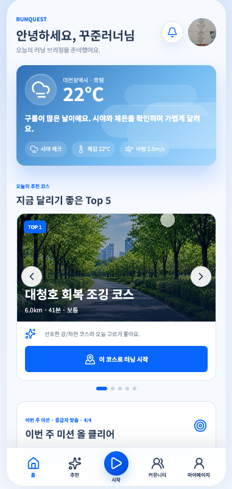
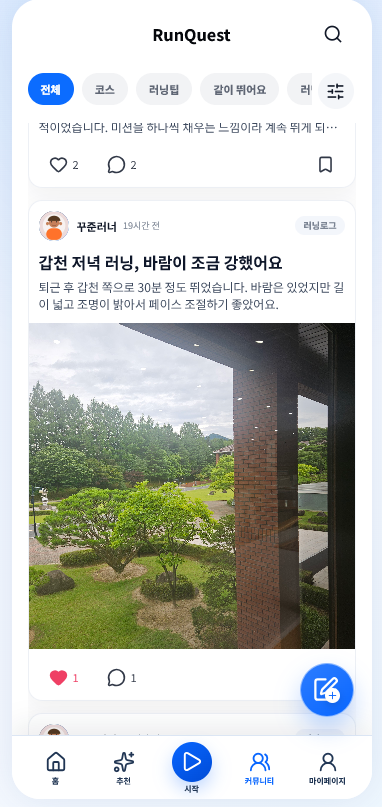

# RunQuest

사용자의 설문, 러닝 기록, 현재 위치를 바탕으로 오늘 달리기 좋은 대전 러닝 코스를 추천하고, 러닝 기록을 배지와 커뮤니티로 이어주는 AI 기반 러닝 추천 서비스입니다.

Vue 3 + Django REST Framework로 개발했으며, Capacitor로 안드로이드 앱 빌드까지 지원합니다.

## 주요 기능

| 기능 | 설명 |
| --- | --- |
| AI 코스 추천 | 설문 결과와 최근 20회 러닝 기록을 점수화해 사용자 상태(신규·기존·복귀)에 맞는 코스를 추천하고, 추천 이유를 자연어로 함께 제공 |
| AI 챗봇 | "야경이 좋은 3km 코스 알려줘"처럼 자연어로 조건을 말하면 조건에 맞는 코스를 추천 |
| GPS 러닝 기록 | 위치 동의 후 실시간 경로·거리·페이스를 측정해 저장. 시뮬레이션 모드도 제공 |
| 러닝 피드백 | 이전 기록과 비교한 페이스·거리 변화를 AI가 짧은 문장으로 피드백 |
| 코스 관리 | 코스 북마크, 지도에서 직접 그리기, GPX 파일 가져오기 |
| 커뮤니티 | 게시글·댓글·좋아요·북마크, 코스 연동 |
| 배지·출석 | 러닝 목표 달성에 따른 배지 획득, 출석 캘린더 |
| 날씨·미세먼지 | 현재 위치 기준 날씨와 미세먼지 정보를 러닝 시작 화면에 표시 |

## 추천 알고리즘

기존 러닝 앱은 모든 사용자에게 비슷한 코스를 보여주거나, 초보자와 복귀 러너의 상태를 충분히 반영하지 못하는 경우가 많습니다. RunQuest는 러너를 세 상태로 나누고 각 상태에 맞는 추천 방식을 적용합니다.

| 사용자 상태 | 추천 방식 |
| --- | --- |
| 신규 사용자 | 러닝 기록이 없으므로 설문(러닝 경력, 페이스, 선호 환경 등)을 점수화해 추천 |
| 기존 사용자 | 설문과 최근 20회 러닝 기록을 함께 반영하고, 현재 위치도 반영 |
| 복귀 사용자 | 최근 30일 이상 완료 기록이 없는 사용자. 설문과 과거 기록을 합한 점수에 안전 보정을 추가 |

핵심 코스 랭킹은 설명 가능한 규칙 기반 점수화로 결정하고, 생성형 AI는 추천 이유 설명·챗봇 응답·러닝 피드백 문구 생성에 사용합니다. 외부 LLM 키가 없으면 로컬 규칙 기반 응답으로 자동 대체됩니다.

## 기술 스택

| 영역 | 사용 기술 |
| --- | --- |
| Frontend | Vue 3, Pinia, Vue Router, Vite, Axios, Lucide Icons |
| Mobile | Capacitor (Android) |
| Backend | Django, Django REST Framework, SimpleJWT, drf-spectacular |
| Database | SQLite (개발), PostgreSQL 전환 가능 |
| 외부 API | Kakao Map JavaScript SDK, Kakao Local REST API, OpenWeather API, OpenAI 호환 Chat Completions API |
| 배포 | Docker, docker-compose, Nginx, Gunicorn, WhiteNoise |

## 아키텍처

```
Vue 3 SPA / Capacitor App
        │  REST (JWT)
        ▼
Django REST Framework ──▶ 추천 엔진 (규칙 기반 점수화)
        │                 ├─▶ LLM (추천 이유·챗봇·피드백 문구)
        │                 ├─▶ OpenWeather (날씨·미세먼지)
        │                 └─▶ Kakao Local (주소·장소)
        ▼
     SQLite / PostgreSQL
```

상세 내용은 [docs/ARCHITECTURE.md](docs/ARCHITECTURE.md), [docs/ERD.md](docs/ERD.md), [docs/API_SPEC.md](docs/API_SPEC.md)를 참고하세요.

## 데이터 모델

- **User / UserSettings**: 회원 정보와 알림·단위 설정
- **SurveyResponse**: 선호 거리·난이도·러닝 환경 등 설문 결과
- **Course / CustomCourse / FavoriteCourse**: 대전 러닝 코스(GPX 기반 경로 포함), 사용자가 직접 만든 코스, 북마크
- **RunningRecord**: 이동 거리, 소요 시간, 평균 페이스, 경로, AI 피드백
- **RecommendationSession**: 추천 요청과 결과 이력
- **Badge / UserBadge / Attendance**: 배지와 출석
- **CommunityPost / CommunityComment / Like / Bookmark**: 커뮤니티
- **ChatSession / ChatMessage**: 챗봇 대화 이력
- **Notification**: 알림

## 실행 방법

### 1. 환경 변수

```bash
cp .env.example .env
cp frontend/.env.example frontend/.env
```

`.env`에 다음 값을 채웁니다. 외부 API 키가 없어도 기본 기능은 동작합니다.

| 변수 | 설명 |
| --- | --- |
| `DJANGO_SECRET_KEY` | Django 시크릿 키 |
| `VITE_KAKAO_MAP_APP_KEY` | Kakao Map JavaScript 키 (지도 표시) |
| `KAKAO_REST_API_KEY` | Kakao Local REST 키 (주소 검색) |
| `OPENWEATHER_API_KEY` | 날씨·미세먼지 |
| `OPENAI_API_KEY` / `LLM_KEY` | 생성형 AI 피드백·챗봇 (없으면 로컬 규칙 기반으로 동작) |

### 2. Backend

```bash
cd backend
python -m venv .venv
.venv/Scripts/activate      # Windows
pip install -r requirements.txt
python manage.py migrate
python manage.py load_runquest_fixtures --reset   # 시연 데이터
python manage.py runserver
```

### 3. Frontend

```bash
cd frontend
npm install
npm run dev
```

`http://localhost:5173`에서 확인할 수 있습니다.

### 4. Docker

```bash
docker compose up --build
```

### 5. Android 앱

```bash
cd frontend
npm run build
npx cap sync android
npx cap open android
```

## 실행 화면

`실행화면/` 폴더에 주요 화면 캡처가 있습니다.

| 메인 | AI 추천 | 러닝 기록 | 커뮤니티 |
| --- | --- | --- | --- |
|  |  |  |  |

## 테스트

```bash
cd backend
python manage.py test core
```

## 팀

| 이름 | 역할 |
| --- | --- |
| 최상진 | Frontend(Vue), AI 기능 구현, 추천 알고리즘 설계 |
| 조규홍 | Backend(Django), 데이터 수집·구축, API 관리 |

## 향후 계획

- 클라우드 배포 (현재는 로컬 실행 및 ngrok 기반 시연)
- 실제 사용자 데이터 축적에 따른 추천 알고리즘 고도화
- 실시간 위치 추적 안정화
- 안드로이드 앱 배포

## 출처 및 라이선스

이 프로젝트의 소스 코드는 [MIT License](LICENSE)로 공개합니다.

### 사용 라이브러리

| 라이브러리 | 라이선스 |
| --- | --- |
| [Vue](https://github.com/vuejs/core), [Pinia](https://github.com/vuejs/pinia), [Vue Router](https://github.com/vuejs/router), [Vite](https://github.com/vitejs/vite) | MIT |
| [Axios](https://github.com/axios/axios), [Capacitor](https://github.com/ionic-team/capacitor) | MIT |
| [Lucide Icons](https://github.com/lucide-icons/lucide) | ISC |
| [Django](https://github.com/django/django), [Django REST Framework](https://github.com/encode/django-rest-framework), [drf-spectacular](https://github.com/tfranzel/drf-spectacular), [python-dotenv](https://github.com/theskumar/python-dotenv) | BSD-3-Clause |
| [djangorestframework-simplejwt](https://github.com/jazzband/djangorestframework-simplejwt), [django-cors-headers](https://github.com/adamchainz/django-cors-headers), [WhiteNoise](https://github.com/evansd/whitenoise), [Gunicorn](https://github.com/benoitc/gunicorn) | MIT |
| [Requests](https://github.com/psf/requests) | Apache-2.0 |
| [openai-python](https://github.com/openai/openai-python) | Apache-2.0 |
| [Noto Sans KR](https://fonts.google.com/noto/specimen/Noto+Sans+KR) | SIL Open Font License 1.1 |

### 외부 API

- [Kakao Maps API](https://apis.map.kakao.com/) — 지도 표시와 경로 렌더링. 지도 화면의 Kakao 로고는 Kakao Maps 이용약관에 따라 유지합니다.
- [Kakao Local API](https://developers.kakao.com/docs/latest/ko/local/common) — 주소·장소 검색
- [OpenWeather API](https://openweathermap.org/api) — 날씨와 대기질
- [OpenAI API](https://platform.openai.com/) — 추천 이유, 챗봇 응답, 러닝 피드백 문구 생성 (OpenAI 호환 엔드포인트 사용 가능)

### 이미지 및 데이터

- 코스 사진, 커뮤니티 게시글 사진, 프로필 아바타, 배지 프레임, 히어로 일러스트는 모두 팀에서 생성형 AI(OpenAI 이미지 생성)로 직접 제작했거나 직접 그린 이미지입니다. 실제 인물 사진은 포함되어 있지 않습니다.
- 코스 경로 데이터는 팀에서 준비한 GPX 파일과 직접 설계한 좌표를 기반으로 구축했습니다.
- 시연용 사용자·게시글·기록 데이터(`backend/fixtures/`)는 팀에서 직접 설계한 합성 데이터입니다.
- `실행화면/`의 캡처 이미지에 포함된 지도 타일은 Kakao Maps의 저작물입니다.
