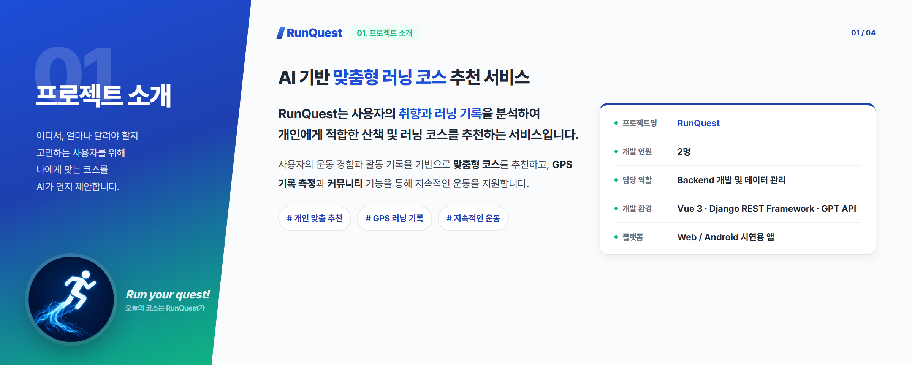
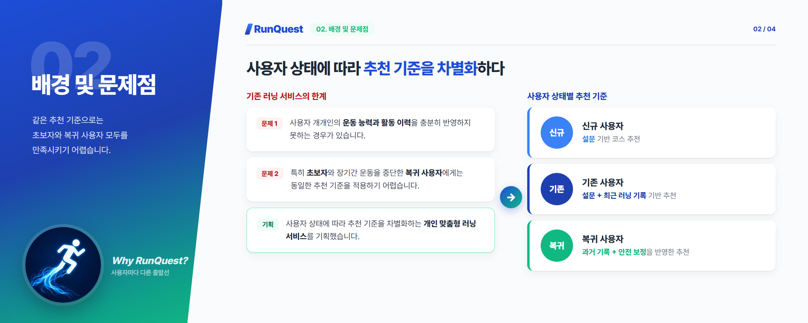
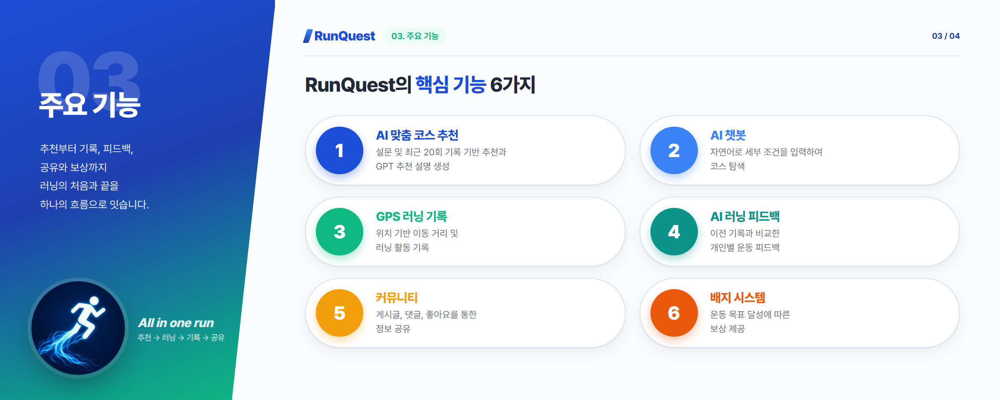
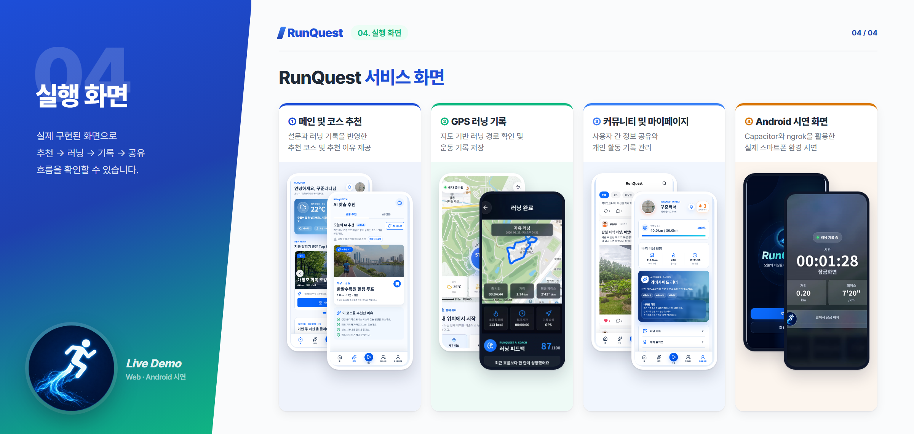
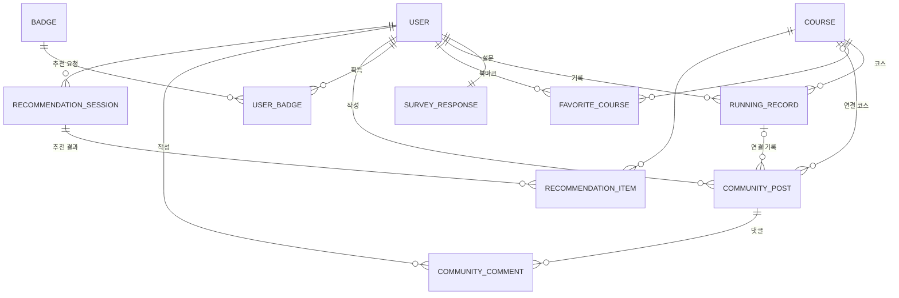

# 🏃 RunQuest — AI 기반 맞춤형 러닝 코스 추천 서비스

## 05. 담당 역할

### 조규홍 — Backend / 데이터 관리

- Django REST Framework 기반 REST API 개발
- 회원 및 러닝 기록 관련 데이터 처리
- 사용자 설문, 코스, 커뮤니티 데이터 관리
- 데이터베이스 ERD 설계 및 모델링
- 프론트엔드와 백엔드 API 연동
- GPS 기록 및 AI 추천 기능의 서버 연동 지원

### 최상진 — Frontend / AI

- Vue 3 기반 UI 및 프론트엔드 개발
- AI 추천 알고리즘 설계
- GPT API 기반 추천 및 피드백 기능 구현

## 06. 기술 스택 및 선정 이유

| 기술 | 선정 이유 |
| --- | --- |
| Vue 3 / Pinia | 컴포넌트 기반 UI 개발 및 상태 관리 |
| Django REST Framework | Python 기반 REST API 개발과 데이터 모델 관리 |
| OpenAI GPT API (GMS) | 추천 설명과 러닝 피드백의 자연어 생성 |
| Kakao Maps API | 지도 시각화 및 위치 기반 서비스 구현 |
| Capacitor | 기존 Vue 웹 서비스를 모바일 앱으로 전환 |
| ngrok | 로컬 서버의 외부 접속 및 모바일 시연 환경 구성 |

## 07. 기술 구현 정보

### 1) 개인 맞춤형 추천 알고리즘

사용자를 신규, 기존, 복귀 사용자로 분류하고 상태별 추천 기준을 적용했습니다.

| 구분 | 추천 기준 |
| --- | --- |
| 신규 | 설문 결과 점수화 |
| 기존 | 설문 + 최근 20회 기록 + 위치정보 |
| 복귀 | 설문 + 과거 기록 + 안전 보정 |

추천 로직을 통해 적합한 코스를 선정하고, GPT API를 활용해 추천 이유를 자연어로 생성했습니다.

### 2) REST API 및 데이터베이스

Django REST Framework를 이용하여 사용자, 러닝 기록, 코스, 커뮤니티 데이터를 관리하는 API를 개발했습니다.

주요 데이터 모델은 다음과 같습니다.

- **User / SurveyResponse**: 사용자 및 운동 성향
- **Course / RunningRecord**: 코스 정보 및 운동 기록
- **RunningRecord.ai_feedback**: 운동 결과에 대한 AI 피드백
- **CommunityPost / CommunityComment**: 커뮤니티 활동

ERD를 통해 사용자와 러닝 기록, 코스 및 게시글 간의 관계를 정의했습니다.

전체 ERD와 필드 정의는 [docs/ERD.md](docs/ERD.md)에서 확인할 수 있습니다.

### 3) 웹·모바일 연동

Vue 웹 서비스를 Capacitor를 통해 Android 앱 형태로 변환했습니다.

개발 PC에서 실행하는 Django 서버를 ngrok으로 외부에 연결하여 실제 스마트폰에서도 기능을 시연했습니다.

단, 클라우드 배포 및 정식 앱 배포까지 진행하지는 않았습니다.

## 08. 트러블슈팅

### 1) Frontend–Backend API 연동 문제

- **문제**: 프론트엔드와 백엔드 간 API 통신 과정에서 정상적으로 데이터를 주고받지 못하는 상황이 발생했습니다.
- **분석 및 해결 과정**: API 요청·응답 구조와 CORS 설정을 점검하고, 프론트엔드와 백엔드의 연결 환경을 조정했습니다.
- **배운 점**: API의 기능 구현뿐 아니라 클라이언트와 서버의 요청 형식, 응답 구조, 네트워크 환경을 함께 고려해야 한다는 점을 학습했습니다.

### 2) 웹과 모바일 앱의 실행 환경 차이

- **문제**: 웹에서 동작하던 기능이 Android 앱 환경에서는 정상적으로 작동하지 않았습니다.
- **분석 및 해결 과정**: 로컬 서버 접근 방식과 네트워크 설정을 확인하고, ngrok을 활용하여 외부 네트워크에서도 개발 서버에 접근할 수 있는 시연 환경을 구성했습니다.
- **배운 점**: 웹과 앱의 네트워크 환경 차이를 이해하고 배포 환경을 고려한 서버 설계의 필요성을 체감했습니다.

## 09. 학습 내용 및 회고

### 학습한 내용

- Django REST Framework를 활용한 REST API 개발
- Vue 3 프론트엔드와 백엔드 간 데이터 연동
- ERD 모델링 및 관계형 데이터 설계
- GPT API를 활용한 AI 기능 연동 구조 이해
- GPS, Kakao Maps API 및 Capacitor를 활용한 서비스 구현 경험

### 회고

이번 프로젝트를 통해 웹 서비스의 기획부터 데이터베이스 설계, API 개발, 프론트엔드 연동까지 전체 개발 흐름을 경험했습니다.

특히 API 연동과 모바일 시연 환경에서 발생한 문제를 해결하며 기능 개발뿐 아니라 시스템 간 연결과 실행 환경에 대한 이해가 중요하다는 점을 배웠습니다.

## 10. 출처 및 라이선스

### 참고 자료 및 외부 서비스

- [Kakao Maps API](https://developers.kakao.com/docs/ko/kakaomap/common) — 지도 및 위치 기반 기능
- [OpenAI API](https://developers.openai.com/api/docs) — AI 추천 설명 및 피드백 생성 (GMS 경유)
- 코스 데이터 및 이미지 — 코스 경로는 팀에서 준비한 GPX 파일과 직접 설계한 좌표로 구축했고, 코스·게시글 사진과 일러스트는 생성형 AI로 직접 제작했습니다. 실행 화면 캡처의 지도 타일은 Kakao Maps의 저작물입니다.

### 라이선스

본 프로젝트는 교육 및 포트폴리오 목적으로 제작되었습니다.
현재 별도의 오픈소스 라이선스를 적용하지 않았습니다.
