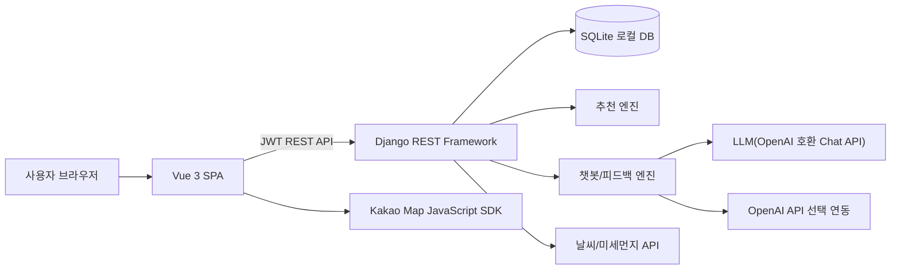

# RunQuest 아키텍처

RunQuest는 Vue SPA 프론트엔드와 Django REST Framework 백엔드를 분리한 구조입니다. 프론트엔드는 화면, 지도, GPS 추적, 상태 관리를 담당하고 백엔드는 인증, 데이터 검증, 추천 계산, 기록 저장, 커뮤니티 API를 담당합니다.

## 전체 구조

## 역할 분리

| 영역 | 역할 |
| --- | --- |
| Vue | 화면 렌더링, 라우팅, Pinia 상태 관리, 지도 표시, GPS 수집 |
| Django | 인증, 권한, 모델 검증, API 응답, 추천 계산, 커뮤니티 처리 |
| SQLite | 로컬 시연용 데이터 저장 |
| Kakao Map | 코스 경로와 러닝 위치 시각화 |
| LLM/OpenAI | 챗봇 응답과 러닝 피드백 문구 생성 보조 |

## 추천 흐름

1. 사용자가 설문을 완료합니다.
2. 위치 권한이 있으면 현재 좌표를 함께 전달합니다.
3. 서버가 사용자 상태를 신규, 기존, 복귀 사용자로 분류합니다.
4. 설문 점수, 최근 러닝 기록, 위치 거리, 안전 보정을 조합해 코스 점수를 계산합니다.
5. 상위 7개 코스를 추천 세션에 저장합니다.
6. 사용자는 현재 추천을 확인하거나 다음 추천으로 넘길 수 있습니다.

## 러닝 기록 흐름

1. 사용자가 코스 또는 자유 러닝을 선택합니다.
2. GPS 모드는 브라우저 위치를 실시간 수집하고, 시뮬레이션 모드는 코스 좌표를 시간에 따라 보간합니다.
3. 진행 중 좌표와 시간은 서버에 임시 저장됩니다.
4. 종료 시 거리, 시간, 페이스, 칼로리, track point가 확정됩니다.
5. 최소 100m 미만 기록은 저장하지 않습니다.
6. 자유 러닝 기록은 완료 후 사용자 코스로 저장할 수 있습니다.

## 커뮤니티 흐름

커뮤니티 게시글은 일반 글, 코스 공유, 러닝 기록 공유를 모두 지원합니다. 목록 API는 빠른 렌더링을 위해 이미지 원본과 상세 nested 데이터를 제외하고, 상세 페이지에서 필요한 데이터를 불러옵니다.

## 배포 구조

| 구성 | 설명 |
| --- | --- |
| `frontend/Dockerfile` | Vite 빌드 결과를 Nginx로 제공 |
| `backend/Dockerfile` | Django 앱을 Gunicorn으로 실행 |
| `docker-compose.yml` | 로컬 컨테이너 실행 예시 |
| HTTPS | 실제 GPS 사용을 위해 필요 |

